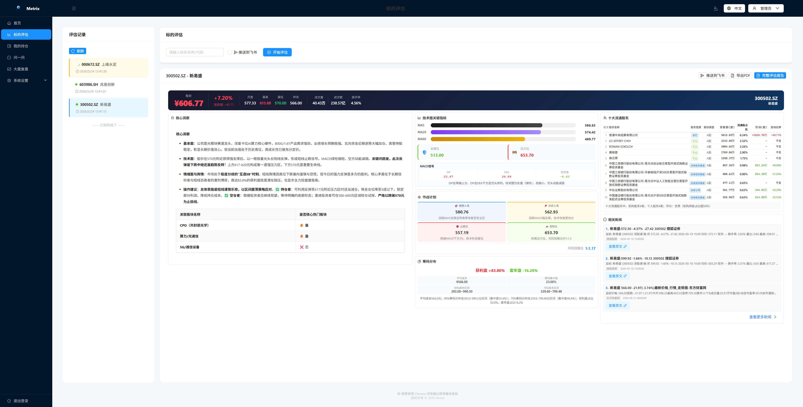
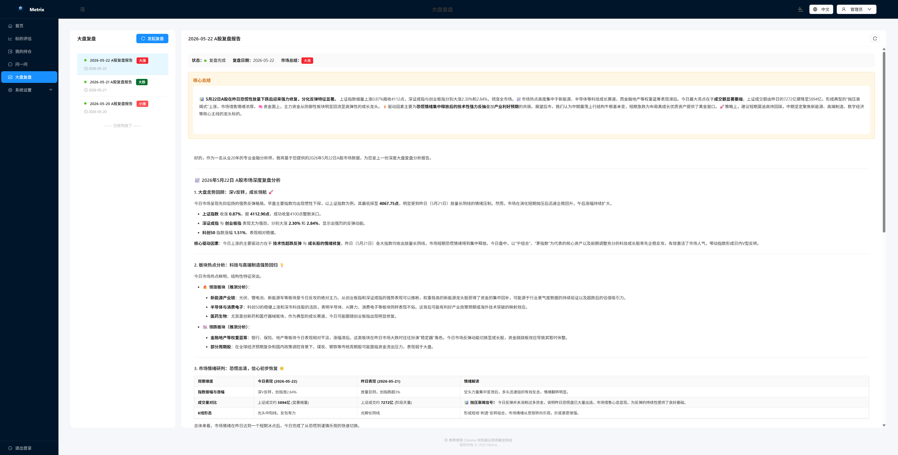
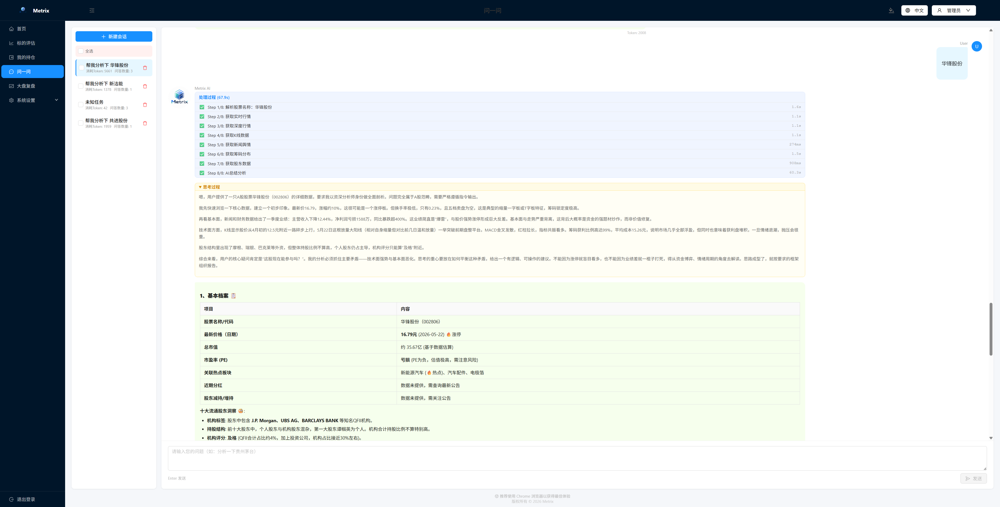

# Metrix

> [English](./README_en.md) | 中文

Metrix = Metric（指标） + Matrix（矩阵）

一个基于量化交易视角的资产评估工具。

## Web界面概览

<p align="center">AI 多维度分析页面</p>


<p align="center">AI 每日市场复盘页面</p>


<p align="center">多轮对话式 AI 分析页面</p>


## 技术栈

| 层级 | 技术                                              |
|------|-------------------------------------------------|
| 后端 | Java 21, Spring Boot 4.0.5, MyBatis-Plus 3.5.15 |
| 数据库 | PostgreSQL 16                                   |
| AI | LangChain4j 0.36.2 (OpenAI / Ollama)            |
| 认证 | Sa-Token 1.45.0 (JWT, 注解鉴权)                  |
| 前端 | Vue 3, Ant Design Vue, Vite                     |
| 数据源 | 同花顺金融数据 API (行情), 博查 (新闻), AKshare (基础数据)          |
| 工具 | Hutool 5.8.13, Lombok                           |

## 功能特性

- **AI 智能分析** — 集成大模型对股票进行多维度分析（技术面、资金面、消息面）
- **AI 问一问** — 支持多轮对话式分析，实时追踪 8 步处理过程的耗时与状态，Markdown 流式渲染
- **主题切换** — 内置 5 种主题色（天空蓝/翡翠绿/暮光紫/落日橙/极光青），基于 Ant Design Vue Design Token 全局生效
- **实时行情** — 通过同花顺金融数据 API 获取基础报价、前复权日 K 数据，MACD 本地计算
- **新闻聚合** — 通过博查 API 获取相关股票新闻并自动摘要
- **筹码分析** — 通过 AKShare 获取最近交易日的筹码指标（前复权），包括获利比例、成本区间与集中度，无需行情 API Key
- **大盘复盘** — 对每日 A 股主要指数进行 AI 复盘分析，生成市场总结与趋势研判
- **持仓管理** — 多账户持仓管理，支持批量录入、一键评估、实时盈亏监控
- **飞书通知** — 分析完成后通过飞书 Webhook 推送结果
- **多模型支持** — 支持 OpenAI 兼容接口和 Ollama 本地模型
- **国际化** — 支持中文和英文界面
- **权限管理** — 基于 RBAC 的权限系统，支持角色/菜单/接口三级权限控制，接口粒度的注解鉴权，动态菜单展示
- **账号与验证** — 管理员使用账号、密码和图形验证码登录；普通用户通过邮箱注册、邮箱验证码和密码登录，支持重置密码与隐私政策确认

## 快速开始

### 环境要求

- JDK 21
- Maven 3.9+
- Node.js 22+
- PostgreSQL 16
- Redis 7+
- Python 3.10+（用于行情和分析脚本）

### 本地开发

```bash
# 0. 安装行情脚本依赖，并确保 PostgreSQL 和 Redis 已启动
pip install -r python-service/requirements.txt

# 1. 配置数据库
cp backend/.env.example backend/.env
# 编辑 backend/.env 填入 PostgreSQL、Redis 和 SMTP 配置

# 2. 初始化数据库
psql -h 127.0.0.1 -U postgres -d stock_analysis -f backend/.doc/db/ddl-init.sql
psql -h 127.0.0.1 -U postgres -d stock_analysis -f backend/.doc/db/dml-init.sql
psql -h 127.0.0.1 -U postgres -d stock_analysis -f backend/.doc/db/system_menu.sql
psql -h 127.0.0.1 -U postgres -d stock_analysis -f backend/.doc/db/system_api.sql

# 3. 启动后端
mvn -f backend/pom.xml clean package -DskipTests
java -jar backend/target/metrix-1.6.1.jar

# 4. 启动前端（新终端）
cd frontend
npm install
npm run dev
```

前端默认运行在 `http://localhost:5173`，后端 API 在 `http://localhost:8080`。

### 已有数据库升级

先备份现有数据库，按待发布版本提供的实际迁移脚本升级。完整初始化 SQL 位于 `backend/.doc/db/`，仅用于新数据库，不应在已有数据库重复导入。详见 [公网部署指南中的升级与回滚](docs/public-deployment.md#升级与回滚)。

### Docker 部署

复制根目录环境变量模板，设置独立的数据库、Redis 和管理员密码：

```bash
cp .env.example .env
chmod 600 .env
# 编辑 .env，填写 POSTGRES_PASSWORD、REDIS_PASSWORD、ADMIN_PASSWORD。
docker compose config --quiet
docker compose up -d --build --wait --wait-timeout 300
```

访问 `http://127.0.0.1:8088`。首次空数据卷会自动初始化表、账号、菜单和接口权限；已有数据卷不会重复初始化。服务包括前端、Java/Python 后端、PostgreSQL 和 Redis，只有前端回环地址映射到宿主机。

公网部署在 `.env` 中填写 `METRIX_DOMAIN` 和 `ACME_EMAIL`，配置 DNS 与 80/443 安全组后执行：

```bash
docker compose -f docker-compose.yml -f docker-compose.public.yml up -d --build --wait --wait-timeout 300
```

完整的服务器准备、SMTP、HTTPS、验证、备份、升级和故障排查步骤见 [公网部署指南](docs/public-deployment.md)。

### 前端单独部署（非 Docker）

```bash
cd frontend

# 安装依赖
npm install

# 构建生产包
npm run build

# 方式一：使用 nginx 部署（推荐）
# 将 dist/ 目录拷贝到 nginx 的 html 目录下，并配置 nginx.conf 代理 /api 到后端

# 方式二：使用 Vite 预览（仅开发/测试）
npm run preview
```

前端默认运行在 `http://localhost:4173`（preview）或 nginx 配置的端口，后端 API 需可访问。

## 项目结构

```
Metrix/
├── backend/                 # Java Spring Boot 后端
│   ├── src/main/java/com/bintech/metrix/
│   ├── src/main/resources/  # 应用配置
│   ├── .doc/db/             # 表结构、账号、菜单和接口种子数据
│   └── Dockerfile
├── frontend/                # Vue 3 前端与 Nginx 配置
│   └── src/
│       ├── views/
│       ├── components/
│       ├── api/
│       ├── router/
│       ├── composables/
│       └── i18n/
├── python-service/          # 后端调用的 Python 行情脚本
├── deploy/                  # HTTPS 和管理员初始化配置
├── docs/public-deployment.md
├── docker-compose.yml
├── docker-compose.public.yml
└── .env.example             # Docker 环境变量模板
```

## 配置说明

系统通过环境变量配置，支持 `.env` 文件：

| 变量 | 默认值 | 说明 |
|------|--------|------|
| `POSTGRES_URL` | `jdbc:postgresql://127.0.0.1:5432/stock_analysis` | 数据库连接地址 |
| `POSTGRES_USERNAME` | `postgres` | 数据库用户名 |
| `POSTGRES_PASSWORD` | `postgres` | 数据库密码 |

### 认证、验证码与邮件

完整配置示例见 [`backend/.env.example`](./backend/.env.example)。普通用户注册时必须勾选隐私政策；系统将把同意状态和时间写入 `users.privacy_agreed`、`users.privacy_agreed_time`。

- `AUTH_CAPTCHA_ENABLED=true`：管理员登录、普通用户登录和发送邮箱验证码均须校验图形验证码。仅本地联调可设为 `false`，前后端会同时跳过该校验。
- `MAIL_HOST`、`MAIL_PORT`、`MAIL_USERNAME`、`MAIL_PASSWORD`、`AUTH_MAIL_FROM`：SMTP 发信配置。邮箱验证码发送采用独立执行器，并在服务端限制同一邮箱每分钟一次。
- 普通用户登录后自动获得非管理端权限；管理端路由与 `/api/admin/**` 接口仅向管理员开放。

### AI 模型配置

通过前端配置页可管理 AI 模型：
- **OpenAI 兼容**：填写 API Base URL、API Key、模型名称
- **Ollama**：填写 Ollama 服务地址和模型名称

### 数据源配置

- **同花顺金融数据 API（FUYAO）**：基础报价、前复权日 K 和当日指数成交额。市场数据配置中填写 `https://fuyao.aicubes.cn` 和新的 API Key；旧行情 Key 不通用。换手率、量比暂缺，显示为空。历史成交额仍使用 Baostock。文档：https://fuyao.aicubes.cn/docs/
- **博查**：新闻数据，需配置 API Key
- **标的数据**：配置并启用同花顺金融数据 API 后，在标的数据页面点击“同步”。按完整股票代码新增或更新 A 股名称和代码，未变化记录不写库；已有行业、上市日期等信息保留。未配置时提供前往配置页的引导。

> **注意**：Windows 下使用 AKShare 时如遇网络代理错误，系统会自动清除子进程的 `HTTP_PROXY`/`HTTPS_PROXY` 环境变量，确保直连外网。

## API 概览

所有 API 以 `/api` 为前缀，部分接口需要登录认证（Sa-Token JWT）。共 100+ 个 API 端点，完整列表见 `backend/.doc/db/system_api.sql`。

### 业务接口

| 端点 | 说明 |
|------|------|
| `POST /api/auth/admin/login` | 管理员账号、密码、图形验证码登录 |
| `POST /api/auth/user/login` | 普通用户邮箱、密码、图形验证码登录 |
| `POST /api/auth/user/register` | 普通用户注册（需邮箱验证码和隐私政策同意） |
| `POST /api/auth/user/password/reset` | 校验邮箱验证码后重置普通用户密码 |
| `POST /api/auth/email-code` | 发送注册或重置密码邮箱验证码（受图形验证码及频率限制） |
| `GET /api/auth/captcha` | 获取图形验证码 |
| `GET /api/auth/verification-config` | 获取图形验证码启用状态 |
| `GET  /api/auth/permissions` | 获取当前用户权限列表 |
| `POST /api/analysis` | 提交分析任务 |
| `GET  /api/analysis` | 分析记录列表 |
| `GET  /api/analysis/{id}/detail` | 分析报告详情 |
| `POST /api/market-review/trigger` | 发起大盘复盘 |
| `GET  /api/market-review` | 复盘记录列表 |
| `POST /api/chat/session` | 创建对话会话 |
| `GET  /api/chat/sessions` | 会话列表 |
| `POST /api/chat/send` | 发送消息（SSE 流式响应） |
| `GET  /api/portfolio/holdings` | 持仓列表 |
| `POST /api/portfolio/holdings/batch` | 批量新增持仓 |
| `GET  /api/stock-basic/page` | 标的数据（分页） |
| `POST /api/stock-basic/sync` | 增量同步 A 股标的（需金融数据 API 配置） |
| `GET  /api/stocks/search` | 标的搜索 |

### 管理接口

| 端点 | 说明 | 权限 |
|------|------|------|
| `GET  /api/admin/users` | 用户列表 | `system:user:list` |
| `PUT  /api/admin/users/{id}/freeze` | 冻结用户 | `system:user:freeze` |
| `GET  /api/admin/roles` | 角色列表 | `system:role:list` |
| `POST /api/admin/roles/{id}/menus` | 分配菜单权限 | `system:role:assign-menu` |
| `POST /api/admin/roles/{id}/apis` | 分配接口权限 | `system:role:assign-api` |
| `GET  /api/admin/menus/tree` | 菜单树 | `system:menu:list` |
| `POST /api/admin/menus` | 创建菜单 | `system:menu:create` |
| `GET  /api/admin/apis` | 接口列表 | `system:api:list` |

## 开发指南

- 遵循 MyBatis-Plus 条件构造器方式进行数据库操作，禁止手写 SQL
- 实体类继承 `BaseEntity`，使用 Lombok 注解
- 控制器只做参数校验和请求转发，业务逻辑在 Service 层
- 使用构造函数注入，禁止 `@Autowired`
- 数据库变更脚本统一放在 `.doc/db/` 下


## 许可证

MIT License | Copyright © 2026 bin.li

标的同步权限元信息迁移脚本：`backend/.doc/db/V20260907_01__stock_basic_sync.sql`。迁移保持原 API ID 和角色授权关系；代码在迁移期间兼容原标的导入权限，CSV 导入接口已移除。
